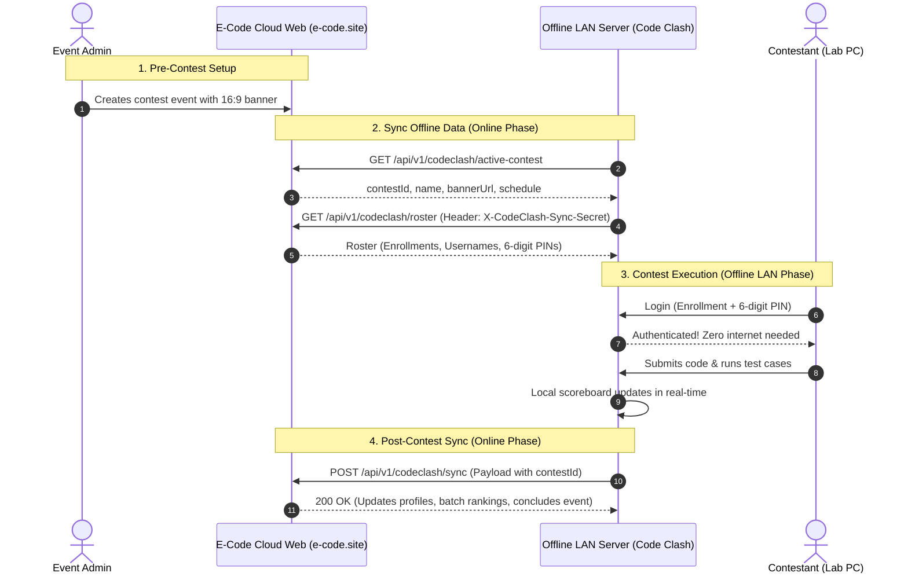

# Code Clash Offline LAN Contest Integration Guide

This guide specifies the exact endpoints, security credentials, request/response formats, and step-by-step instructions for the offline LAN server and the Codex agent working on Code Clash.

---

## 1. System Overview



---

## 2. API Endpoints Summary

| Method | Endpoint | Auth Required | Description |
| :--- | :--- | :--- | :--- |
| `GET` | `/api/v1/codeclash/active-contest` | Optional / Public | Fetches current live or upcoming contest details (`contestId`, `name`, `bannerUrl`, `date`, `startTime`, `endTime`, `durationMinutes`). |
| `GET` | `/api/v1/codeclash/roster` | `X-CodeClash-Sync-Secret` | Exports full student roster with enrollment numbers and 6-digit Contest PINs for offline authentication. |
| `POST` | `/api/v1/codeclash/sync` | `X-CodeClash-Sync-Secret` | Ingests final LAN standings, links participant scores to student profiles, updates batch leaderboards, and marks event as ended. |
| `GET` | `/api/v1/codeclash/leaderboards` | Public | Retrieves cumulative batch or global rankings (`?batch=2024`, `?batch=all`). |
| `GET` | `/api/v1/codeclash/leaderboards/contests/:contestId` | Public | Retrieves round-specific standings for any contest. |

---

## 3. Pre-Contest: Active Contest Specification API

### Request
* **URL:** `GET https://ecode-backend.onrender.com/api/v1/codeclash/active-contest`
* **Query Parameters (Optional):**
  * `contestId`: Target specific contest ID.
  * `eventId`: Target specific event document ID.

### Response (`HTTP 200 OK`)
```json
{
  "success": true,
  "message": "Active contest details retrieved successfully",
  "data": {
    "contestId": "YJQAc3fZaKPD2Gyz6AYm",
    "eventId": "YJQAc3fZaKPD2Gyz6AYm",
    "name": "Code Clash Fall 2024",
    "description": "Speed coding contest covering Arrays, Graphs, Dynamic Programming.",
    "bannerUrl": "https://pub-r2.e-code.site/events/codeclash.png",
    "date": "2026-11-25",
    "startTime": "16:00",
    "endTime": "18:00",
    "durationMinutes": 120,
    "status": "UPCOMING",
    "isEnded": false,
    "isPublished": true,
    "totalProblems": 5,
    "batchTarget": "ALL"
  }
}
```

> **CRITICAL RULE:**
> Cache `data.contestId`. You **must** supply this exact `contestId` when pushing final results to `POST /api/v1/codeclash/sync`.

---

## 4. Pre-Contest: Roster Export & Offline PIN Login

### Request
* **URL:** `GET https://ecode-backend.onrender.com/api/v1/codeclash/roster`
* **Header:** `X-CodeClash-Sync-Secret: <YOUR_SECRET>`

### Response (`HTTP 200 OK`)
```json
{
  "success": true,
  "message": "Student roster exported successfully for offline LAN server",
  "data": {
    "totalStudents": 45,
    "exportedAt": "2026-11-22T10:05:00.000Z",
    "roster": [
      {
        "enrollmentNumber": "U2451001",
        "username": "alex_coder",
        "fullName": "Alex Johnson",
        "batchYear": "2024",
        "contestPin": "749201"
      },
      {
        "enrollmentNumber": "U2561011",
        "username": "riya_dev",
        "fullName": "Riya Sharma",
        "batchYear": "2025",
        "contestPin": "382910"
      }
    ]
  }
}
```

---

## 5. Post-Contest: Result Sync API

### Request
* **URL:** `POST https://ecode-backend.onrender.com/api/v1/codeclash/sync`
* **Headers:**
  * `Content-Type: application/json`
  * `X-CodeClash-Sync-Secret: <YOUR_SECRET>`

### Payload
```json
{
  "contestId": "YJQAc3fZaKPD2Gyz6AYm",
  "title": "Code Clash Fall 2024",
  "description": "2-hour speed coding contest covering Arrays, Graphs, DP.",
  "startTime": "2026-11-25T16:00:00.000Z",
  "endTime": "2026-11-25T18:00:00.000Z",
  "durationMinutes": 120,
  "totalProblems": 4,
  "batchTarget": "ALL",
  "problems": [
    { "problemId": "A", "title": "Subarray Maximum XOR", "maxPoints": 100 },
    { "problemId": "B", "title": "Shortest Path in Weighted DAG", "maxPoints": 150 },
    { "problemId": "C", "title": "Grid Traversal with Obstacles", "maxPoints": 200 },
    { "problemId": "D", "title": "String Permutations", "maxPoints": 250 }
  ],
  "participants": [
    {
      "rank": 1,
      "enrollmentNumber": "U2451001",
      "username": "alex_coder",
      "fullName": "Alex Johnson",
      "batchYear": "2024",
      "score": 600,
      "problemsSolved": 4,
      "timePenaltyMinutes": 68,
      "solvedProblems": ["A", "B", "C", "D"]
    },
    {
      "rank": 2,
      "enrollmentNumber": "U2561011",
      "username": "riya_dev",
      "fullName": "Riya Sharma",
      "batchYear": "2025",
      "score": 450,
      "problemsSolved": 3,
      "timePenaltyMinutes": 75,
      "solvedProblems": ["A", "B", "C"]
    }
  ]
}
```

### Success Response (`HTTP 200 OK`)
```json
{
  "success": true,
  "message": "Code Clash LAN contest results synchronized successfully for contestId: \"YJQAc3fZaKPD2Gyz6AYm\"",
  "data": {
    "contestId": "YJQAc3fZaKPD2Gyz6AYm",
    "eventId": "YJQAc3fZaKPD2Gyz6AYm",
    "contestTitle": "Code Clash Fall 2024",
    "participantsSynced": 2,
    "batchesUpdated": ["2024", "2025", "all"],
    "syncedAt": "2026-11-25T18:05:00.000Z"
  }
}
```
